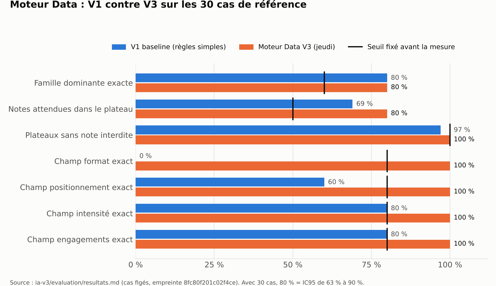
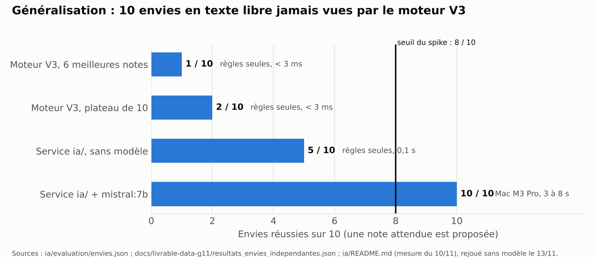
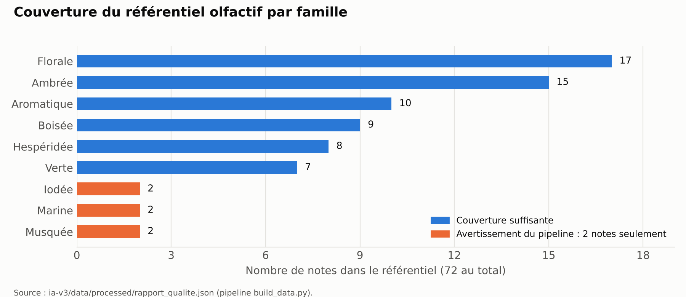

# L'ATELIER — Livraison Data & IA | Vendredi 13 novembre 2026

**Équipe :** G11 YAMA, thématique 02 « La plateforme de commande intelligente »  
**Livraison collective :** Ali Mghari et Hamza Laztouti (Data), avec l'équipe Tech pour l'intégration du service `ia/`  
**Repository :** [hackathon-app / develop](https://github.com/Hackathon-Givaudan/hackathon-app/tree/develop)  
**Service Data/IA du prototype :** [`ia/` sur develop](https://github.com/Hackathon-Givaudan/hackathon-app/tree/develop/ia)  
**Moteur Data V3 :** [`ia-v3/` sur feature/data-ia-v3](https://github.com/Hackathon-Givaudan/hackathon-app/tree/feature/data-ia-v3/ia-v3) (version 3.1.0)  
**Rapport PDF :** [G11_Livrables_Vendredi_13-11-2026.pdf](docs/G11_Livrables_Vendredi_13-11-2026.pdf)

## Synthèse des cinq livrables

| Livrable demandé                                  | Travail réalisé et preuve                                                                                                                                                                                                                                                                     |
| ------------------------------------------------- | --------------------------------------------------------------------------------------------------------------------------------------------------------------------------------------------------------------------------------------------------------------------------------------------- |
| **1. Code et documentation finalisés**            | Deux briques complémentaires : le service `ia/` qui fait tourner le prototype (79 tests dans la CI) et le moteur Data V3 (pipeline, 72 fiches matières, 24 routes, 28 tests). Les données, les règles et les décisions sont documentées (README, dictionnaire des données, ADR 0005 et 0008). |
| **2. Procédure de reproduction des résultats**    | Commandes Docker et Python pour chaque brique. Rejouées le 13/11 depuis GitHub : mêmes données, mêmes métriques sur les 30 cas et les 10 cas V3, même résultat sur les envies indépendantes. Contre-validation déjà faite sur un deuxième ordinateur (PR #100).                               |
| **3. Comparaison V1/V2 avec métriques**           | V1 (règles simples, mardi) contre moteur V3 (jeudi) sur 30 cas figés, avec seuils fixés avant la mesure et IC95. Mesure complémentaire du service `ia/` sur 15 envies écrites par une autre personne que l'auteur du moteur V3.                                                               |
| **4. Analyse des limites et des biais**           | 12 limites constatées et chiffrées : auto-évaluation, généralisation faible du moteur V3 (2 envies sur 10), banque fictive, valeurs estimées, familles sous-représentées, mesures du LLM sur une seule machine.                                                                               |
| **5. Résultats Data intégrés à la démonstration** | Le parcours appelle l'API réelle : les envies deviennent des notes du référentiel, chaque note a sa fiche matière sourcée, la formule est la référence la plus proche, et le conseiller reçoit le potentiel en 7 critères. Les résultats et leurs limites sont visualisés ci-dessous.         |

## 1 — Code, données et documentation livrés

Le prototype aide une petite marque à passer de ses envies à une première formule. La Data fournit **le référentiel et la banque**, **la traduction des envies en notes** et **les preuves** de ce que vaut cette traduction. Le travail est réparti entre **le service `ia/`**, intégré au prototype et seul à appeler le modèle (ADR 0005 et 0010), et **le moteur Data V3**, plus complet, dont le service a repris les données et les règles. Par défaut, le modèle est **`mistral:7b` via Ollama** (ADR 0008), et le service continue de fonctionner sans lui.

| Composant                        | Ce qui a été réalisé                                                                                                                                                                            | Preuve principale                                                                                                                                                                                                                                                                                                                                            |
| -------------------------------- | ----------------------------------------------------------------------------------------------------------------------------------------------------------------------------------------------- | ------------------------------------------------------------------------------------------------------------------------------------------------------------------------------------------------------------------------------------------------------------------------------------------------------------------------------------------------------------ |
| **Service `ia/` (prototype)**    | Envies → étiquettes (liste fermée) → notes justifiées ; formule = référence la plus proche ; fiche matière ; potentiel en 7 critères ; séance écrite avec Aurore. 6 routes FastAPI, 79 tests.   | [`ia/app/`](https://github.com/Hackathon-Givaudan/hackathon-app/tree/develop/ia/app), [`ia/README.md`](https://github.com/Hackathon-Givaudan/hackathon-app/blob/develop/ia/README.md)                                                                                                                                                                        |
| **Données du service**           | 40 références fictives du Product (20 parfums, 20 arômes), 72 fiches matières sourcées, axes fraîcheur et chaleur de 78 notes, règle des deux versions, critères du potentiel, modèle de brief. | [`ia/data/`](https://github.com/Hackathon-Givaudan/hackathon-app/tree/develop/ia/data), PR [#86](https://github.com/Hackathon-Givaudan/hackathon-app/pull/86) et [#94](https://github.com/Hackathon-Givaudan/hackathon-app/pull/94)                                                                                                                          |
| **Profils Scento**               | 50 profils de parfums publics, traduits au format de la banque, avec un audit ligne par ligne des traductions et la correspondance avec le vocabulaire du Product.                              | [`README_sources.md`](https://github.com/Hackathon-Givaudan/hackathon-app/blob/develop/ia/data/README_sources.md), PR [#42](https://github.com/Hackathon-Givaudan/hackathon-app/pull/42)                                                                                                                                                                     |
| **Spike envies → notes (mardi)** | Premier contrat OpenAPI des routes Data/IA (5 routes), référentiel de notes et mesure de `qwen2.5:7b` sur un PC sans carte graphique.                                                           | [`ia/spike-envies/`](https://github.com/Hackathon-Givaudan/hackathon-app/tree/feature/spike-envies-notes/ia/spike-envies)                                                                                                                                                                                                                                    |
| **Pipeline de préparation (V3)** | 13 sources nettoyées et fusionnées en 13 fichiers ; contrôles bloquants ; rapport qualité ; résultat identique à chaque exécution.                                                              | [`pipeline/build_data.py`](https://github.com/Hackathon-Givaudan/hackathon-app/blob/feature/data-ia-v3/ia-v3/pipeline/build_data.py), [`rapport_qualite.json`](https://github.com/Hackathon-Givaudan/hackathon-app/blob/feature/data-ia-v3/ia-v3/data/processed/rapport_qualite.json)                                                                        |
| **Moteur Data V3**               | Brief structuré (11 champs), roue et radar, plateau de 10 notes sous contraintes, 3 pistes, 3 références proches, potentiel, Mistral en option. 24 routes, 28 tests.                            | [`app/moteur.py`](https://github.com/Hackathon-Givaudan/hackathon-app/blob/feature/data-ia-v3/ia-v3/app/moteur.py), [`regles_metier.md`](https://github.com/Hackathon-Givaudan/hackathon-app/blob/feature/data-ia-v3/ia-v3/docs/regles_metier.md)                                                                                                            |
| **Référentiel des familles**     | 6 familles de parfums et 6 axes d'arômes, avec définitions, exemples et limites.                                                                                                                | PR [#69](https://github.com/Hackathon-Givaudan/hackathon-app/pull/69)                                                                                                                                                                                                                                                                                        |
| **Fiches matières documentées**  | 10 fiches relues par Tech ; les champs non vérifiés restent vides.                                                                                                                              | PR [#79](https://github.com/Hackathon-Givaudan/hackathon-app/pull/79)                                                                                                                                                                                                                                                                                        |
| **Évaluation**                   | 30 cas de référence et 10 cas V3 figés ; 15 envies du service `ia/` (10 projets, 5 textes absurdes) ; historique des exécutions.                                                                | [`ia-v3/evaluation/`](https://github.com/Hackathon-Givaudan/hackathon-app/tree/feature/data-ia-v3/ia-v3/evaluation), [`ia/evaluation/`](https://github.com/Hackathon-Givaudan/hackathon-app/tree/develop/ia/evaluation)                                                                                                                                      |
| **Contre-validation**            | Pipeline, tests et 30 cas rejoués sur un deuxième ordinateur ; 6 écarts de famille analysés.                                                                                                    | PR [#87](https://github.com/Hackathon-Givaudan/hackathon-app/pull/87) et [#100](https://github.com/Hackathon-Givaudan/hackathon-app/pull/100)                                                                                                                                                                                                                |
| **Documentation et décisions**   | Dictionnaire des données, protocole de validation, ADR sur la place du code Data (0005), le modèle (0008) et l'accès unique au modèle (0010) ; livrable de jeudi.                               | [`docs/adr/`](https://github.com/Hackathon-Givaudan/hackathon-app/tree/develop/docs/adr), [`donnees.md`](https://github.com/Hackathon-Givaudan/hackathon-app/blob/feature/data-ia-v3/ia-v3/docs/donnees.md), PR [#103](https://github.com/Hackathon-Givaudan/hackathon-app/pull/103) et [#108](https://github.com/Hackathon-Givaudan/hackathon-app/pull/108) |

**Sources des données.** Origines et procédés : articles Wikipédia de chaque matière, avec la date de consultation et un statut (« confirmée », « déduite », « estimation équipe Data »). Images et sons : Wikimedia Commons, uniquement domaine public, CC0, CC BY et CC BY-SA, avec l'auteur. Allergènes : règlement (CE) 1223/2009, annexe III. Profils de parfums : Scento Perfume Database, CC BY 4.0. Écrans, familles et critères : maquettes du Product et réponses de Givaudan citées dans la V3. Aucune formule Givaudan et aucune donnée personnelle ne sont utilisées.

## 2 — Reproduction des résultats

**Environnement :** Docker Desktop, ou Python 3.12 ou plus. Ollama et `mistral:7b` ne sont nécessaires que pour mesurer le modèle.

```
git clone https://github.com/Hackathon-Givaudan/hackathon-app
cd hackathon-app
```

**Lancer tout le prototype**

```
docker compose up                       # front, API, PostgreSQL et service ia/ ; http://localhost:5173
ollama pull mistral:7b                  # facultatif : sans lui, ia/ cherche les mots de la marque dans le référentiel
```

**Exécuter les tests du service `ia/`**

```
docker build -t hackathon-ia ia
docker run --rm -v "$PWD/ia":/ia -w /ia hackathon-ia sh -c "pip install -q -r requirements-dev.txt && python -m pytest -q"
# attendu : 79 passed (rejoués par la CI à chaque pull request)
```

**Mesurer le service `ia/` sur les 15 envies**

```
docker run --rm -p 8000:8000 hackathon-ia
python ia/evaluation/evaluate.py http://localhost:8000
# attendu sans modèle : 10 / 15 (5 envies sur 10, 5 textes absurdes refusés sur 5)
```

**Rejouer le moteur Data V3**

```
git switch feature/data-ia-v3
cd ia-v3
pip install -r requirements.txt
python pipeline/build_data.py           # 72 notes, 9 familles, 18 ambiances, 0 erreur bloquante, 3 avertissements connus
python -m pytest -q tests               # 28 passed
python evaluation/evaluate.py           # écrit evaluation/resultats.md et resultats.json
```

**Mesurer le moteur V3 sur les envies indépendantes**

```
git switch docs/livrable-data-g11-ajouts-ali
git worktree add ../ia-v3-source feature/data-ia-v3
python docs/livrable-data-g11/mesure_envies_independantes.py ../ia-v3-source/ia-v3 ia/evaluation/envies.json
```

Rejoué le 13/11/2026 à partir de GitHub : le pipeline produit les mêmes 13 fichiers, l'évaluation du moteur V3 redonne les mêmes valeurs sur les 30 cas et les 10 cas V3 (seule la latence change selon la machine), et le service `ia/`, sans modèle, refait 10 / 15 sur les envies (versions de mardi et de jeudi). L'intégrité du jeu de référence se vérifie par son empreinte SHA-256 (`8fc80f201c02f4ce`). Les mesures avec `mistral:7b` n'ont été faites que sur un Mac M3 Pro : leur temps de réponse ne se reproduit pas sur un PC sans carte graphique.

## 3 — Comparaison V1 mardi / V2 jeudi et métriques

**Versions comparées :** Gate 1 de mardi ([spike](https://github.com/Hackathon-Givaudan/hackathon-app/tree/feature/spike-envies-notes/ia/spike-envies), service `ia/` au commit `cfe95f8`, V1 à règles simples) ; prototype de jeudi (service `ia/` au commit `fe89f3a` sur develop, moteur Data V3 au commit `a88757e`).

| Dimension                   | V1 — mardi 10/11                                                                     | V2 — jeudi 12/11                                                                                                                     |
| --------------------------- | ------------------------------------------------------------------------------------ | ------------------------------------------------------------------------------------------------------------------------------------ |
| **Données**                 | Banque de 40 références fictives du Product et 50 profils Scento, sans fiche matière | 72 fiches matières sourcées (40 champs), 9 familles, 18 ambiances, axes de 78 notes, critères du potentiel et modèle de brief        |
| **Envies → notes**          | Mots de la marque cherchés dans le référentiel, modèle en complément                 | Inchangé dans `ia/` (aucune régression) ; moteur V3 : brief en 11 champs, roue, radar, plateau de 10 notes sous contraintes          |
| **Contraintes**             | Aucune : vegan, naturel, durable et allergènes ignorés                               | Engagements, domaine Fragrances ou Arômes, format et allergènes respectés                                                            |
| **Ce que reçoit la marque** | Des notes justifiées et une formule (référence la plus proche)                       | En plus : fiche matière de chaque note, potentiel en 7 critères pour le conseiller, formule en deux versions, 3 pistes, 3 références |
| **LLM**                     | `qwen2.5:7b` sur PC sans GPU : 58 s médian, 40 % des notes attendues (51 % sans IA)  | `mistral:7b` par défaut (ADR 0008), choix limité aux étiquettes du référentiel, repli sur les règles                                 |
| **Évaluation**              | 10 envies du spike, aucun seuil sur le plateau                                       | 30 cas figés avant la première exécution, seuils fixés à l'avance, IC95 de Wilson, jeu indépendant                                   |



| Résultat                                                   | Mesure publiée                                                               |
| ---------------------------------------------------------- | ---------------------------------------------------------------------------- |
| Famille dominante exacte (seuil 60 %), 30 cas              | V1 **80 %** ; V3 **80 %** (IC95 63 % à 90 %)                                 |
| Famille attendue dans le top 3 (seuil 85 %)                | V1 **100 %** ; V3 **100 %**                                                  |
| Notes attendues retrouvées dans le plateau (seuil 50 %)    | V1 **69 %** ; V3 **79 %** avant corrections, **80 %** après                  |
| Plateaux sans note interdite (seuil 100 %)                 | V1 **97 %** (non atteint) ; V3 **100 %**                                     |
| Champ format exact (seuil 80 %)                            | V1 **0 %** ; V3 **97 %** avant corrections, **100 %** après                  |
| Champs positionnement, intensité, engagements (seuil 80 %) | V1 **60 à 80 %** ; V3 **100 %**                                              |
| 12 champs du brief, 10 cas V3 (seuil 80 %)                 | V3 **100 %**                                                                 |
| Bonne référence parmi les 3 proposées (seuil 70 %)         | V3 **100 %** (IC95 72 % à 100 %), contre **34 %** au hasard                  |
| Latence p95 (seuil 5 s)                                    | V1 **0,2 ms** ; V3 **0,8 à 2,2 ms** ; `qwen2.5:7b` sur CPU **58 s**          |
| Service `ia/`, 10 envies + 5 textes absurdes, sans modèle  | mardi **10 / 15** ; jeudi **10 / 15** (rejoué le 13/11)                      |
| Service `ia/`, mêmes 15 cas, avec `mistral:7b`             | **15 / 15**, de 3,3 à 8,1 s (Mac M3 Pro) ; textes absurdes refusés **8 / 8** |



Le gain de la V2 porte d'abord sur ce que la V1 ne savait pas faire : respecter les engagements de la marque et remplir son brief. Sur la famille dominante, les deux versions restent à 80 % : les erreurs viennent de cas qui mélangent deux familles proches, et la bonne famille est toujours dans le top 3. Sur des envies jamais vues, en revanche, le moteur V3 ne fait que 2 sur 10, contre 5 sur 10 pour le service `ia/` sans modèle et 10 sur 10 avec Mistral. C'est pourquoi le prototype garde l'analyse des envies du service `ia/` et reprend du V3 ses données et ses règles.

**Preuves :** [`ia-v3/evaluation/resultats.md`](https://github.com/Hackathon-Givaudan/hackathon-app/blob/feature/data-ia-v3/ia-v3/evaluation/resultats.md), [`run1_avant_corrections.md`](https://github.com/Hackathon-Givaudan/hackathon-app/blob/feature/data-ia-v3/ia-v3/evaluation/historique/run1_avant_corrections.md), [`resultats_envies_independantes.json`](https://github.com/Hackathon-Givaudan/hackathon-app/blob/docs/livrable-data-g11-ajouts-ali/docs/livrable-data-g11/resultats_envies_independantes.json), [`ia/README.md`](https://github.com/Hackathon-Givaudan/hackathon-app/blob/develop/ia/README.md) (mesure du 10 novembre), [ADR 0008](https://github.com/Hackathon-Givaudan/hackathon-app/blob/develop/docs/adr/0008-mistral-7b-modele-par-defaut.md).

## 4 — Analyse des limites et des biais

Les bons chiffres de la section 3 viennent surtout de jeux écrits par l'équipe qui a construit les règles. Le jeu indépendant montre que la généralisation reste le point faible. Les limites ci-dessous sont celles qu'un jury ou un vrai client ferait apparaître en premier.



| Sujet                           | Constat scientifique                                                                                                                                                | Suite méthodologique                                                                                                   |
| ------------------------------- | ------------------------------------------------------------------------------------------------------------------------------------------------------------------- | ---------------------------------------------------------------------------------------------------------------------- |
| **Auto-évaluation**             | Les 30 cas et les 10 cas V3 ont été écrits par l'équipe Data, et les 15 envies par l'auteur du service `ia/` : chaque jeu est optimiste pour le code de son auteur. | Faire écrire 10 briefs par le Product ou de vraies marques, sans les montrer avant la mesure.                          |
| **Généralisation du moteur V3** | 2 envies sur 10 jamais vues réussies ; aucun mot reconnu dans 5 sur 10. Le lexique reconnaît les notes et les familles nommées, pas les ambiances ni les usages.    | Garder l'analyse du service `ia/` ; enrichir le lexique d'ambiances et d'usages avant toute autre réutilisation du V3. |
| **Corrections après lecture**   | 3 défauts ont été corrigés après avoir vu les erreurs des 30 cas : l'exécution 2 est un peu optimiste.                                                              | L'exécution 1, avant corrections, reste la mesure de référence.                                                        |
| **Banque fictive**              | Les références sont inventées pour la démonstration : le 100 % de « bonne référence » ne dit rien d'une vraie banque, et la formule n'a pas de proportions réelles. | Brancher une banque fournie par Givaudan au même format, puis refaire la mesure.                                       |
| **Valeurs estimées**            | Axes olfactifs, accords et poids des questions sont estimés par l'équipe Data, pas mesurés sur des panels.                                                          | Faire valider par un parfumeur ; tester les duels avec des utilisateurs.                                               |
| **Familles sous-représentées**  | Marine, iodée et musquée n'ont que 2 notes chacune, contre 17 en florale : le plateau y offre peu de choix.                                                         | Ajouter des notes dans ces familles (avertissements du pipeline).                                                      |
| **Fruits et gourmand**          | Les familles de la maquette n'ont ni fruitée ni gourmande : discutable pour les arômes (cas C21, mangue et citron vert).                                            | Trancher avec le Product ; la colonne `facette` permet de changer vite.                                                |
| **Origines et allergènes**      | 47 origines confirmées par la source, 5 en partie, 20 notes de synthèse sans origine. Allergènes de 28 notes issus du règlement, pas des fiches fournisseurs.       | Confirmer avec les fiches fournisseurs de Givaudan ; la fiche n'affiche que ce qui est confirmé.                       |
| **Traductions Scento**          | Les notes des 50 profils sont traduites par des règles ; une partie du lexique n'est pas validée par le Product, et ambiances, émotions et usages restent vides.    | Relire `audit_traductions.csv` avec le Product avant de proposer ces profils au geste 1.                               |
| **Taille des échantillons**     | 30 cas, 10 cas V3, 15 envies : avec 30 cas, 80 % veut dire entre 63 % et 90 % (IC95).                                                                               | Élargir les jeux avant de comparer des versions proches.                                                               |
| **Mesures du LLM**              | Une seule passe par modèle, sur un Mac M3 Pro ; sur les PC de l'équipe sans GPU, un modèle 7B dépasse largement le seuil de 5 s.                                    | Répéter les mesures et en faire une sur la machine de la démonstration.                                                |
| **Langue et forme**             | Français uniquement ; fautes et argot non gérés. Les métriques des pistes vérifient la forme, pas la pertinence olfactive.                                          | Faire juger les plateaux et les pistes par le Product ou un parfumeur.                                                 |

## 5 — Contribution Data à la démonstration finale

**Brief de démonstration :** « Une bougie qui rappelle le bord de mer, pour un moment d'évasion ». Dans le parcours, la Data permet à la marque de :

1. voir ses envies traduites en notes du référentiel (sel marin, ozone, algue…), chacune avec la raison qui la justifie ;
2. ouvrir la fiche matière de chaque note, avec son origine, ses engagements et sa source ;
3. recevoir une formule : la référence existante la plus proche des notes gardées, expliquée ;
4. transmettre au conseiller un brief accompagné de son potentiel, critère par critère.

Rien n'est inventé : le modèle ne choisit que des étiquettes du référentiel, et ce qui est simulé (banque fictive, compte, devis) est signalé à l'écran. Les chiffres présentés au jury sont ceux de la section 3, avec les limites de la section 4.

### Accès direct aux preuves

- [Service Data/IA du prototype (`ia/`)](https://github.com/Hackathon-Givaudan/hackathon-app/tree/develop/ia)
- [Moteur Data V3 et son livrable de jeudi](https://github.com/Hackathon-Givaudan/hackathon-app/blob/feature/data-ia-v3/ia-v3/LIVRABLE.md)
- [Livrable Data G11 de jeudi (PR #103 et #108)](https://github.com/Hackathon-Givaudan/hackathon-app/pull/108)
- [Résultats officiels sur les 30 cas et les 10 cas V3](https://github.com/Hackathon-Givaudan/hackathon-app/blob/feature/data-ia-v3/ia-v3/evaluation/resultats.md)
- [Protocole de validation, biais et limites](https://github.com/Hackathon-Givaudan/hackathon-app/blob/feature/data-ia-v3/ia-v3/docs/protocole_validation.md)
- [Dictionnaire des données et licences](https://github.com/Hackathon-Givaudan/hackathon-app/blob/feature/data-ia-v3/ia-v3/docs/donnees.md)
- [Sources des profils Scento](https://github.com/Hackathon-Givaudan/hackathon-app/blob/develop/ia/data/README_sources.md)
- [Rapport de contre-validation (PR #100)](https://github.com/Hackathon-Givaudan/hackathon-app/pull/100)
- [ADR 0008 : choix de `mistral:7b`](https://github.com/Hackathon-Givaudan/hackathon-app/blob/develop/docs/adr/0008-mistral-7b-modele-par-defaut.md)
- [Spike envies → notes de mardi](https://github.com/Hackathon-Givaudan/hackathon-app/tree/feature/spike-envies-notes/ia/spike-envies)
- [Figures de ce livrable](docs/figures/)
