# Livrable Data/IA : preuves point par point

Service : `ia-v3/` (modèle 3.0.0, qui reprend la V2 et ajoute le brief V3, les références proches et le potentiel). Ticket : #72.
Toutes les vérifications ci-dessous ont été faites le 12/11/2026 ; les captures sont dans `docs/livrable/`.

| # | Point demandé | Statut | Où le voir | Preuve |
|---|---|---|---|---|
| 1 | Données nettoyées et préparées | Fait | `data/sources/` → `data/processed/`, `docs/donnees.md` | 72 notes, 9 familles, 18 ambiances, chaque donnée avec sa source et sa date |
| 2 | Pipeline de traitement fonctionnel | Fait | `pipeline/build_data.py`, `data/processed/rapport_qualite.json` | 0 erreur bloquante, test `test_pipeline.py` |
| 3 | Modèle publié | Fait | `app/moteur.py`, branche `feature/data-ia-v3` | 10 commits, ce dossier |
| 4 | Métriques et protocole de validation sur 30 cas | Fait | `evaluation/`, `docs/protocole_validation.md` | tous les seuils atteints |
| 5 | API fonctionnelle renvoyant les résultats réels du modèle | Fait | `app/main.py`, `docs/openapi.json` | 23 routes, 21 tests sur 21 |

## 1. Données nettoyées et préparées

13 fichiers sources (notes, enrichissement, familles, médias, ambiances, duels, radar, lexique, allergènes, modèle de brief, critères du potentiel, banque de références fictive) sont nettoyés et fusionnés en 13 fichiers prêts à l'emploi. Chaque fiche matière porte son origine et sa source, ses engagements (naturel, vegan, durable), ses points de vigilance, ses allergènes et une image sous licence libre avec auteur et date.

Fiche matière renvoyée par l'API (`GET /notes/bergamote`) :

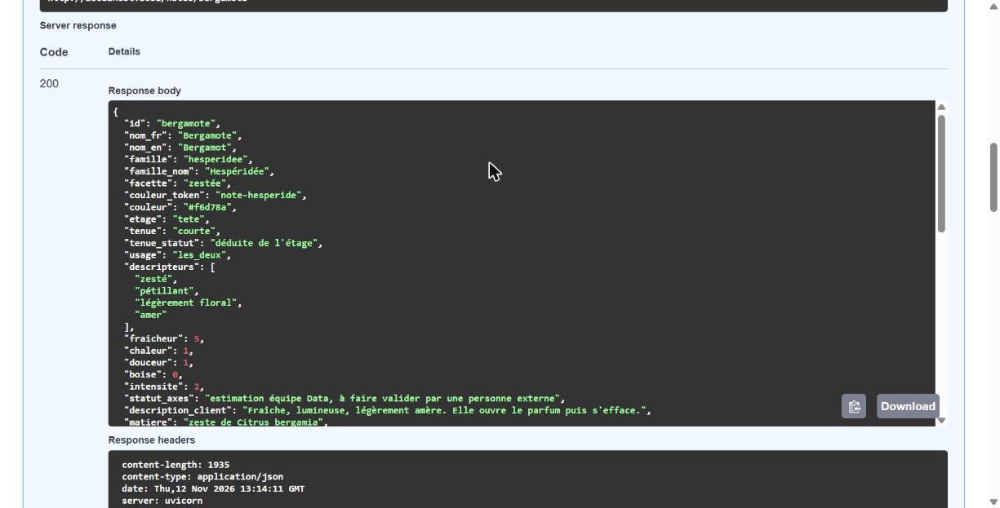
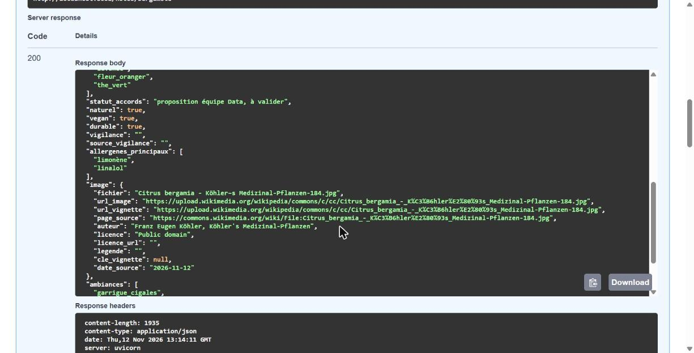

## 2. Pipeline de traitement fonctionnel

```bash
python pipeline/build_data.py
# avec Docker : docker run --rm data-ia python pipeline/build_data.py
```

Sortie (extrait) :

```
 "notes": 72,
 "familles": 9,
 "ambiances": 18,
 "notes_par_etage": {"tete": 30, "coeur": 23, "fond": 19},
 "notes_naturelles": 53,
 "notes_avec_allergenes_connus": 28,
 "references_fictives": 34,
 "duels": 5,
 "origines": {"confirmée par la source": 47, "confirmée en partie": 5, "accord ou synthèse": 20},
 "bloquants": []
3 avertissement(s)
  - famille marine : seulement 2 note(s)
  - famille iodee : seulement 2 note(s)
  - famille musquee : seulement 2 note(s)
kit_atelier.json écrit
```

Le pipeline s'arrête avec un code d'erreur si une règle bloquante échoue. Relancé deux fois, il produit exactement les mêmes fichiers. Les 3 avertissements sont connus : il faut plus de notes marines, iodées et musquées.

## 3. Modèle publié

Le modèle est dans `app/moteur.py`, sans LLM : le spike #50 a montré qu'un modèle 7B sur CPU met 58 s par requête pour un seuil de 5 s. Les règles sont expliquées dans `docs/regles_metier.md`.

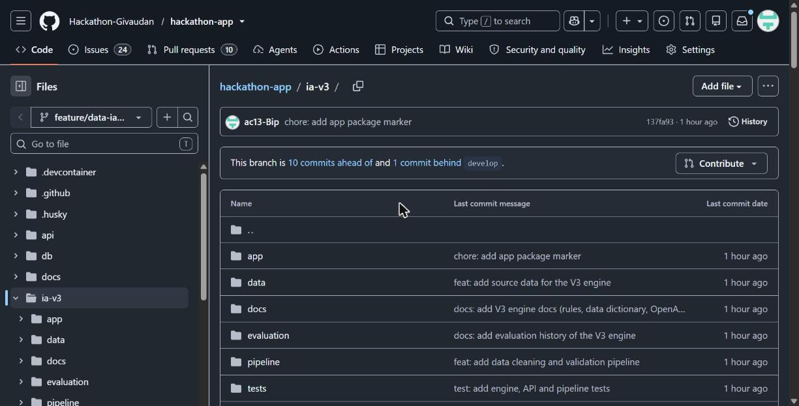
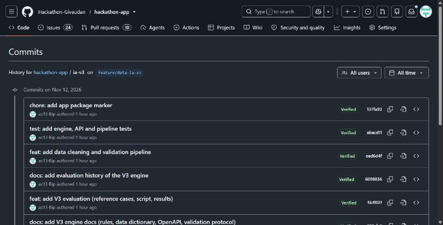

## 4. Métriques et protocole de validation sur 30 cas

Les 30 cas (`evaluation/cas_reference.json`, empreinte SHA-256 `8fc80f201c02f4ce`) ont été rédigés avant la première exécution, et les seuils ont été fixés avant aussi. Le protocole, les résultats avant et après corrections, les biais et les limites sont dans `docs/protocole_validation.md`.

| Métrique | Seuil | V1 (règles simples) | Modèle 3.0.0 |
|---|---|---|---|
| Famille dominante exacte | 60 % | 80 % | 80 % |
| Notes attendues retrouvées dans le plateau | 50 % | 69 % | 80 % |
| Plateaux sans note interdite | 100 % | 97 % | 100 % |
| Champs du brief exacts | 80 % | 0 à 80 % | 100 % |
| Latence p95 | < 5 s | 0,2 ms | 2,6 ms |

Plus 10 cas V3 : 100 % des champs du brief exacts, et la bonne référence est dans les 3 propositions dans 100 % des cas (contre 34 % au hasard). Limite connue : le lexique a été écrit par l'équipe qui a rédigé les cas, donc ces chiffres sont optimistes. Il faut maintenant des briefs que l'équipe Data n'a pas vus.

```bash
python evaluation/evaluate.py                         # en local
python evaluation/evaluate.py http://localhost:8000   # via l'API
```

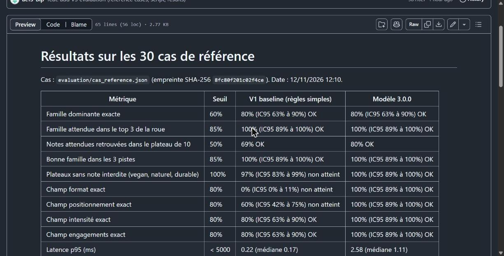
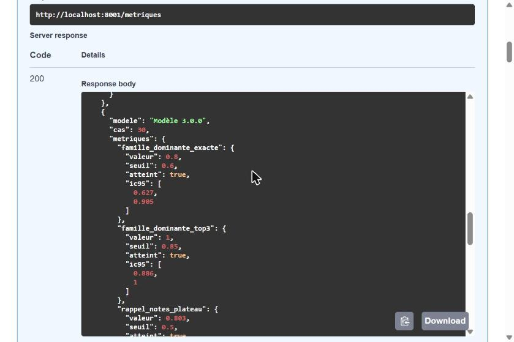

## 5. API fonctionnelle renvoyant les résultats réels du modèle

```bash
docker build -t data-ia .
docker run --rm data-ia sh -c "pip install -q pytest httpx && python -m pytest -q tests"   # 21 passed
docker run -p 8001:8000 data-ia                                                          # http://localhost:8001/docs
```

Chaque route appelle directement `app/moteur.py`, sans aucune donnée simulée. Le contrat complet est dans `docs/openapi.json`.

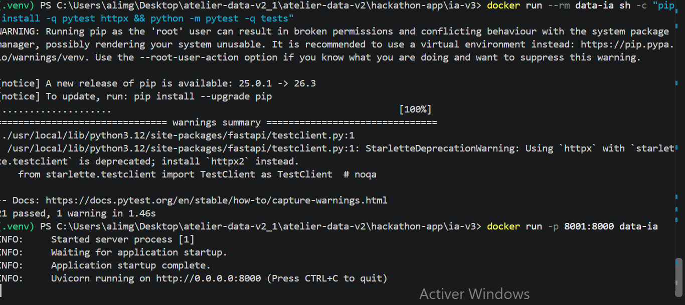
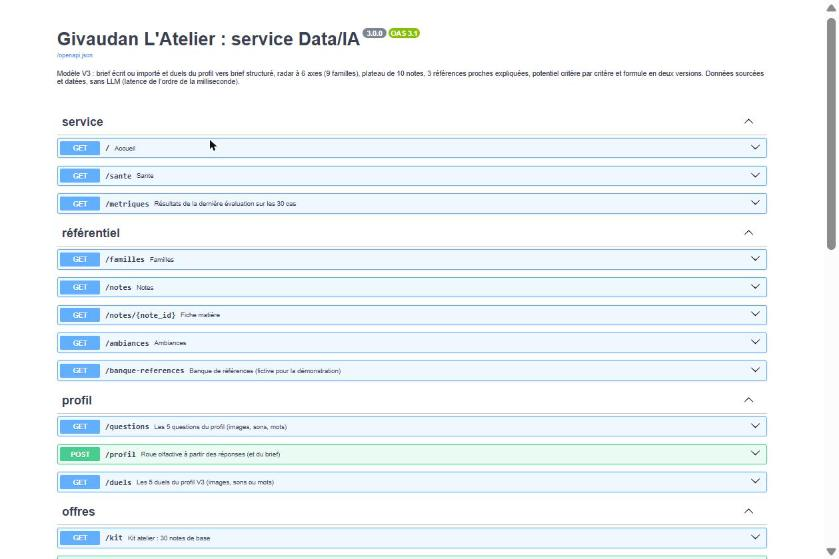
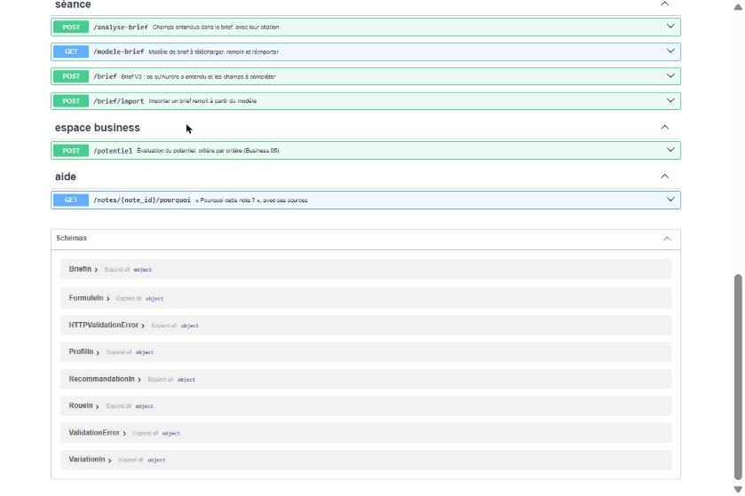

`POST /recommandation` avec le brief « restaurant en bord de mer, bougie fraîche et iodée, prix accessible » :

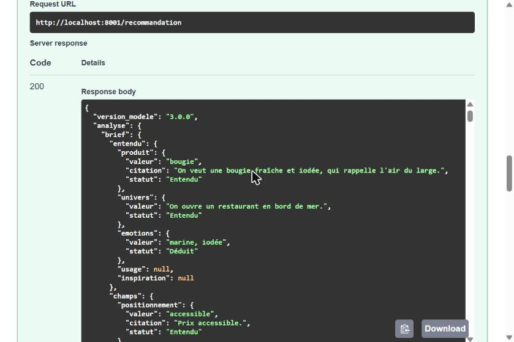
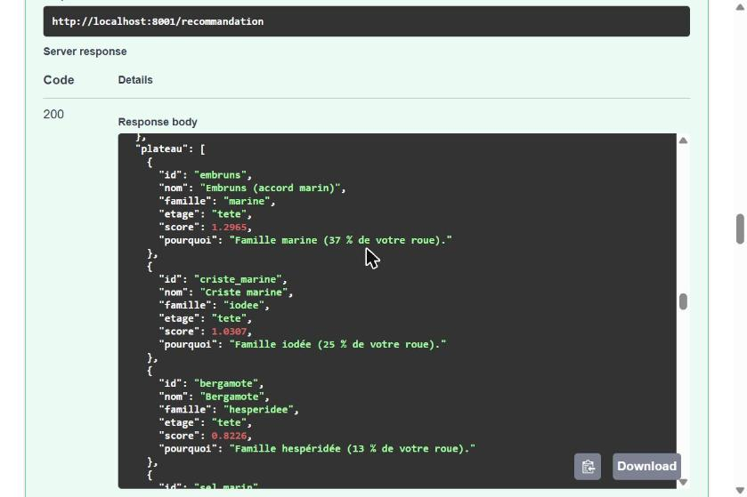
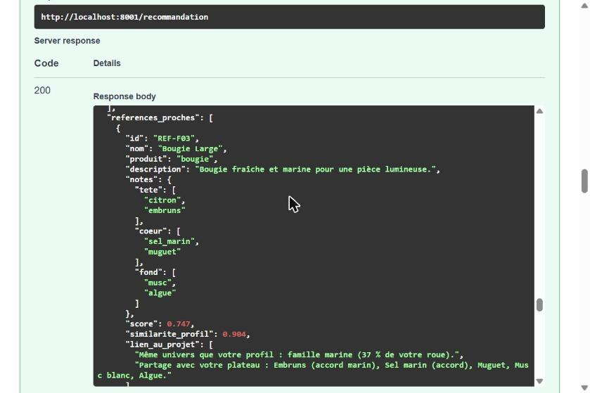

## Ce qui reste à faire

- Brancher `ia-v3` dans `compose.yaml` et `api/` à la place de l'ancien `ia/` (avec les Tech).
- Remplacer la banque de références fictive par la vraie banque de Hamza, au même format.
- Faire relire les cas de référence par une personne extérieure et tester sur des briefs inédits.
- Sous Windows, Smart App Control peut bloquer `pydantic_core` : lancer les tests avec Docker.
